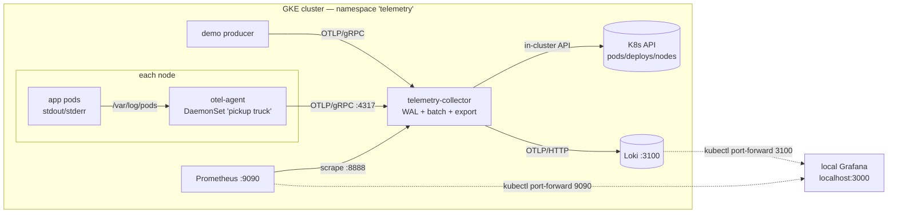

# Deploying to GKE

Run the collector in a GKE cluster where it (a) pulls **Kubernetes state metrics**
from the cluster API and (b) receives **real pod logs** pushed in by a per-node log
agent. Logs land in an in-cluster Loki; the collector's own metrics are scraped by
an in-cluster Prometheus. A **local Grafana** reads both over `kubectl port-forward`
— nothing is exposed publicly.

> This is a disposable study deployment. Run `terraform destroy` when you are done;
> a running cluster costs a few USD per day.

## Architecture



- **Why an agent?** Our collector is a *receiver* — it only accepts OTLP that
  something sends it; it does not scrape node log files. The `otel-agent` DaemonSet
  tails `/var/log/pods` on each node and pushes those logs to the collector as OTLP.
  Our collector still does all the real work (durability, batching, retries, export).
- **Why GKE Standard, not Autopilot?** The agent needs a `hostPath` mount of
  `/var/log`, which Autopilot blocks. Standard allows it.
- **Why port-forward, not a LoadBalancer?** It keeps Loki/Prometheus private and
  costs nothing. Your local Grafana points at `localhost`.

## Prerequisites

- `gcloud`, `kubectl`, `terraform` (≥ 1.5), and Docker installed.
- A GCP project with **billing enabled**.
- Authenticate: `gcloud auth login` and `gcloud auth application-default login`.

## 1 — Provision infrastructure (Terraform)

```sh
cd terraform
cp terraform.tfvars.example terraform.tfvars    # set project_id
terraform init
terraform apply                                 # ~5-10 min
terraform output next_steps
cd ..
```

Point `kubectl` at the new cluster (the exact command is in `terraform output
get_credentials_command`):

```sh
gcloud container clusters get-credentials telemetry-collector \
  --zone us-central1-a --project YOUR_PROJECT_ID
```

## 2 — Build, push, and deploy the workloads

```sh
PROJECT_ID=YOUR_PROJECT_ID REGION=us-central1 sh scripts/gke-deploy.sh
```

By default this builds the image with **Cloud Build** (on GCP, native amd64) and
pushes it to Artifact Registry — no local Docker needed. This is the reliable path
from an **Apple Silicon** workstation, where an emulated local
`docker build --platform linux/amd64` can crash in QEMU during the Go build. To build
locally instead (e.g. on an amd64 machine), pass `BUILDER=docker`.

It then applies the manifests in [deploy/kubernetes](deploy/kubernetes): namespace,
RBAC, Loki, Prometheus, the collector, the log agent, and the demo producer. Skip the
producer with `WITH_PRODUCER=no`.

Check it:

```sh
kubectl -n telemetry get pods
kubectl -n telemetry logs deploy/telemetry-collector | head
```

## 3 — View it in local Grafana

```sh
# Terminal 1 — expose Loki + Prometheus to localhost:
sh scripts/gke-portforward.sh

# Terminal 2 — start Grafana (datasources already point at the forwards):
docker compose -f deploy/local-grafana/compose.yaml up
```

Open **http://localhost:3000** (anonymous viewing; `admin`/`admin` to edit). The
provisioned **Telemetry Collector** dashboard shows ingestion/export rates, queue
and byte usage, and the Kubernetes panels. In **Explore → Loki**, query real pod
logs with e.g. `{service_name="telemetry-demo"}` or `{service_name=~".+"}`.

## Teardown

```sh
kubectl delete namespace telemetry        # releases the PVC-backed disks
cd terraform && terraform destroy         # deletes cluster + registry
```

After `destroy`, confirm no stray disks remain:

```sh
gcloud compute disks list --filter="name~pvc-"
```

Delete any that are left (they are the Loki/Prometheus/WAL volumes) to stop charges.

## Configuration knobs

- **Collector settings** (WAL sync, queue bounds, batching, retries) are environment
  variables on the collector container — see [deploy/kubernetes/collector.yaml](deploy/kubernetes/collector.yaml)
  and the full table in [README.md](README.md#collector-configuration).
- **Which namespaces' state is collected**: `KUBERNETES_NAMESPACE` (empty = all).
- **How many nodes / what size**: `node_count` and `machine_type` in
  [terraform/variables.tf](terraform/variables.tf).
- **Agent log scope / self-exclusion**: the `filelog` `include`/`exclude` globs in
  [deploy/kubernetes/otel-agent.yaml](deploy/kubernetes/otel-agent.yaml).

## Troubleshooting

| Symptom | Check |
| --- | --- |
| Collector pod `ImagePullBackOff` | Did `gke-deploy.sh` push the image? Is the AR reader IAM grant applied (`terraform apply`)? Region in the image path must match `var.region`. |
| Collector `CrashLoopBackOff` with `exec format error` | Image is arm64 — use the default `BUILDER=cloudbuild` (native amd64), not a local emulated build. |
| `gcloud builds submit` errors about a logs bucket | Append `--default-buckets-behavior=REGIONAL_USER_OWNED_BUCKET` to the `gcloud builds submit` line in [scripts/gke-deploy.sh](scripts/gke-deploy.sh), or build with `BUILDER=docker`. |
| Local `docker build` crashes in QEMU on Apple Silicon | Expected — use the default `BUILDER=cloudbuild`. |
| No logs in Loki | `kubectl -n telemetry logs ds/otel-agent` — agent should show it is exporting. Confirm the collector Service name `telemetry-collector:4317` resolves. Remember `start_at: end` means only logs produced *after* the agent started appear. |
| `collector_kubernetes_collection_errors_total{reason="forbidden"}` | RBAC not applied, or the collector is using the wrong ServiceAccount. Re-apply [deploy/kubernetes/rbac.yaml](deploy/kubernetes/rbac.yaml). |
| Grafana datasource "connection refused" | Is `scripts/gke-portforward.sh` still running? On Linux, confirm `host.docker.internal` resolves (the compose file adds `host-gateway`). |
| Agent pod won't schedule / `hostPath` denied | You are on an Autopilot cluster — this setup requires GKE **Standard** (what the Terraform provisions). |
| Otel agent image tag not found | Bump `otel/opentelemetry-collector-contrib` tag in [deploy/kubernetes/otel-agent.yaml](deploy/kubernetes/otel-agent.yaml) to a current release. |
